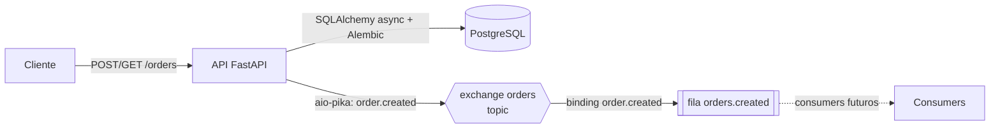

# api-orders

API de pedidos em FastAPI. Cada pedido é gravado no PostgreSQL e, depois do commit, o evento `order.created` é publicado no RabbitMQ.

## Arquitetura



| Serviço | Porta | Observação |
|---|---|---|
| API | 8000 | Documentação interativa em `/docs` |
| PostgreSQL 16 | 5432 | Dados no volume `postgres_data` |
| RabbitMQ 4 | 5672 / 15672 | Painel de administração em `http://localhost:15672` |

## Como rodar

Pré-requisitos: Docker e Docker Compose. Para desenvolvimento local, também [uv](https://docs.astral.sh/uv/) e Python 3.13.

### Tudo no Docker

```bash
cp .env.example .env      # preencha usuários e senhas
docker compose up --build
```

A API só inicia depois que o Postgres e o RabbitMQ passam no healthcheck. Ao subir, o container executa `alembic upgrade head` antes de iniciar o servidor.

### API local, infraestrutura no Docker

```bash
docker compose up -d postgres rabbitmq
cd api
uv sync
uv run alembic upgrade head
uv run fastapi dev main.py
```

O `.env` da raiz tem `DATABASE_URL` e `RABBITMQ_URL` com host `localhost` para esse modo. No Docker, o `docker-compose.yml` sobrescreve os dois com os nomes dos serviços (`postgres` e `rabbitmq`). Se a senha tiver caracteres especiais (`@`, `:`, `/`), ela precisa de URL-encoding dentro dessas URLs.

### Migrations

```bash
cd api
uv run alembic revision --autogenerate -m "descrição"
uv run alembic upgrade head
```

Revise o arquivo gerado antes de aplicar. O autogenerate não cria o tipo `ENUM` do Postgres em `add_column` nem dá nome a constraints únicas.

## Testes

```bash
docker compose up -d postgres
cd api
uv run pytest
```

Os testes rodam contra o Postgres real, mas em um banco separado (`<POSTGRES_DB>_test`), criado automaticamente. O banco de desenvolvimento não é tocado: o conftest recusa qualquer nome que não termine em `_test`. O RabbitMQ é substituído por um coletor em memória, então só o Postgres precisa estar no ar.

Usar o Postgres (e não SQLite) é intencional: o teste de corrida depende da restrição `UNIQUE` e do `IntegrityError` reais. O teste `test_concurrent_requests_with_same_key_create_one_order` reproduz o cenário descrito em [Decisões técnicas](#decisões-técnicas): 10 requisições simultâneas com a mesma chave devem resultar em um `201`, nove `200`, uma única linha no banco e um único evento publicado.

## Endpoints

| Método | Rota | Descrição |
|---|---|---|
| `POST` | `/orders` | Cria um pedido. Aceita o header opcional `Idempotency-Key`. |
| `GET` | `/orders` | Lista todos os pedidos, por ordem de id. |

```bash
curl -X POST http://localhost:8000/orders \
  -H "Content-Type: application/json" \
  -H "Idempotency-Key: $(uuidgen)" \
  -d '{"product": "camiseta", "value": "49.90"}'
```

O corpo aceita apenas `product` e `value`. O `status` começa como `pending` e é decidido pelo sistema; enviar `status` (ou qualquer campo desconhecido) retorna `422`.

| Resultado | Status |
|---|---|
| Pedido criado | `201` |
| Repetição com a mesma chave e o mesmo corpo | `200`, com o pedido original |
| Mesma chave com outro corpo | `422` |
| Corpo inválido (produto vazio, valor `<= 0`, mais de 2 casas decimais) | `422` |

## Evento `order.created`

Publicado na exchange `orders` (tipo `topic`, durável) com a routing key `order.created`. A mensagem é persistente e o `message_id` é o id do pedido. Payload:

```json
{"id": 1, "product": "camiseta", "value": "49.90", "status": "pending", "created_at": "2026-11-05T19:09:31.200134"}
```

A API declara também a fila durável `orders.created`, ligada a essa routing key. Uma exchange `topic` sem fila ligada descarta as mensagens sem aviso. Cada consumer futuro deve declarar a própria fila.

## Decisões técnicas

### Dinheiro com `Decimal`, não `float`
O valor é `Decimal` no Pydantic e `Numeric(12, 2)` no Postgres. `float` acumula erro de arredondamento (`0.1 + 0.2 != 0.3`), o que não é aceitável para valores monetários. O Pydantic limita a 12 dígitos e 2 casas decimais, o mesmo limite da coluna, então um valor fora disso retorna `422` em vez de estourar como erro `500` no banco.

### Status decidido pelo sistema
O modelo de entrada (`OrderCreate`) tem só `product` e `value`. Se aceitasse `status`, o cliente poderia criar um pedido já pago. Com `extra="forbid"`, o campo é rejeitado com `422` em vez de ignorado em silêncio. O modelo de saída (`OrderOut`) é separado e inclui `id`, `status` e `created_at`.

### Idempotência
Cliente que reenvia um `POST` após timeout ou queda de rede não deve criar pedido duplicado. Ele manda o header `Idempotency-Key` (um UUID por intenção de pedido), e a API devolve o pedido original quando a chave já existe.

A API guarda, junto da chave, um SHA-256 do corpo normalizado (`product` sem espaços nas pontas e `value` com 2 casas, então `10`, `10.00` e `"10.0"` geram o mesmo hash). Se a mesma chave chegar com outro corpo, a resposta é `422`, em vez de devolver em silêncio um pedido que não corresponde ao que o cliente pediu. Pedidos sem o header continuam sendo criados normalmente.

Se um campo novo for adicionado ao `OrderCreate`, ele precisa entrar no cálculo de `request_hash`. Caso contrário, dois corpos diferentes teriam o mesmo hash.

### `UNIQUE` no banco e a corrida
Verificar a chave antes de inserir não basta: duas requisições simultâneas com a mesma chave podem passar na verificação ao mesmo tempo. Por isso `idempotency_key` tem uma restrição `UNIQUE` no Postgres, que é quem decide:

1. Cada requisição consulta a chave. Se existir, devolve o original.
2. Se não existir, tenta inserir e dar commit.
3. Em uma corrida, o banco aceita um insert e rejeita o outro com `IntegrityError`.
4. A requisição que perdeu faz rollback, busca o pedido vencedor e o devolve (ou responde `422`, se o corpo for diferente).

Em um teste com 10 requisições simultâneas na mesma chave, houve um `201`, nove `200` e uma única linha no banco. O `UNIQUE` aceita vários `NULL` no Postgres, por isso pedidos sem chave não conflitam entre si.

### Publicação do evento depois do commit
O evento é publicado depois do commit e só na criação (repetições idempotentes não republicam). Se o RabbitMQ estiver indisponível, o pedido é criado mesmo assim e o erro é logado: o pedido é a fonte da verdade, e a conexão se recupera sozinha quando o broker volta.

Limitação conhecida: se a API cair entre o commit e a publicação, ou o broker estiver fora naquele momento, o evento daquele pedido se perde. A solução completa é o padrão *transactional outbox* (gravar o evento numa tabela na mesma transação e publicar por um worker), que não foi implementado.

### Pedidos anteriores ao hash
Pedidos criados com chave antes da coluna `request_hash` existir tiveram o hash calculado na própria migration. Um pedido com chave e sem hash voltaria a devolver o original sem comparar o corpo.
